# Project Documentation: Meta AI Chatbot for Azerbaijani Local Businesses

**Project Title:** Meta AI Chatbot for Azerbaijani Local Businesses  
**Document Type:** Master Engineering & Architecture Documentation  
**Target Environment:** Railway (PaaS), AWS RDS (PostgreSQL), Upstash (Serverless Redis), Pinecone (Vector DB), Meta Cloud API (WhatsApp Cloud API, Instagram Graph API, Facebook Messenger Platform)  
**Methodological Alignment:** Kendall & Kendall / BUCT Structured Analysis & Object-Oriented Design (UML 2.5)  
**Reference Project:** `ALISOY_NIJAT_2026220022_SAD`  

---

## 1. Architecture & Tech Stack Overview

*   **Hosting & CI/CD:** **Railway** (using automatic GitHub deployments and Nixpacks; fully managed, auto-restarting, zero Docker overhead).
*   **Database (Relational & State):** **AWS RDS (PostgreSQL)** for multi-tenant data structures (local business profiles, customer master records, chat session states, message audit ledgers, Facebook Page metadata, and escalation tickets).
*   **Cache & Message Broker:** **Upstash (Serverless Redis)** for high-throughput webhook queuing, event de-duplication, rate limiting, and sub-millisecond session caching.
*   **Vector Database (Knowledge Base):** **Pinecone** for multi-tenant vector storage, housing chunked document embeddings (menus, service pricing, operating hours, delivery zones, and FAQs) retrieved via Retrieval-Augmented Generation (RAG).
*   **Embedding Model:** **OpenAI `text-embedding-3-small`** (1536 dimensions) for high-accuracy semantic embeddings across multi-lingual texts.
*   **AI Provider / LLM Core:** **OpenAI (GPT-4o)** or **Anthropic (Claude 3.5 Sonnet)** with multi-lingual capabilities (Azerbaijani primary, Russian, Turkish, English) and localized prompt engineering tailored to Baku and regional Azerbaijani commerce.
*   **Meta Integration Tier (Multi-Channel):**
    *   **WhatsApp Business Platform / Cloud API:** Two-way customer messaging, media handling, and pre-approved Meta Template messaging outside the 24-hour window.
    *   **Instagram Graph API Messaging:** Direct Message (DM) automation, Story Mentions, and Icebreaker prompts for local consumer brands.
    *   **Facebook Messenger Platform / Graph API:** Full Facebook Page messaging automation (`/v21.0/me/messages`), Webhook subscription (`messages`, `messaging_postbacks`, `message_deliveries`, `message_reads`, `messaging_handovers`), Page-Scoped ID (PSID) mapping, **Facebook Messenger Handover Protocol** (`pass_thread_control` / `take_thread_control` for seamless handoff to Meta Business Suite Page Inbox), **Facebook Message Tags** (`HUMAN_AGENT` providing up to 7-day response windows for human customer support, `POST_PURCHASE_UPDATE`, `CONFIRMED_EVENT_UPDATE`), and rich interactive UI components (Horizontal Generic Carousel Templates, Button Templates, Quick Replies, and Persistent Menus).
*   **Notification Gateway:** **Telegram Bot API** for instant human escalation alerts dispatched directly to business managers' mobile phones.

---

## 2. System Requirements

### 2.1 Functional Requirements (What the system must do)
1.  **Multi-Platform Webhook Ingestion:** The system must receive, validate, and parse incoming webhooks from WhatsApp Cloud API, Instagram Graph API, and Facebook Messenger Platform through a unified gateway.
2.  **Facebook Messenger Event Parsing & Postbacks:** The gateway must parse Facebook Messenger `messaging` events, extracting sender Page-Scoped IDs (PSID), message text, attachments, quick-reply responses, and postback payloads generated by "Get Started" or Persistent Menu button clicks.
3.  **Asynchronous Message Processing:** Incoming messages across WhatsApp, Instagram, and Messenger must be instantly acknowledged with an HTTP 200 OK (< 500 ms) and pushed to an Upstash Redis queue for background worker consumption to prevent Meta timeout retries.
4.  **Multi-Lingual AI Generation:** The bot must accurately detect and reply in Azerbaijani (Latin script with native letters `ə`, `ı`, `ş`, `ç`, `ğ`, `ö`, `ü`), Russian, Turkish, and English, accommodating Baku colloquial code-switching across all channels.
5.  **RAG-based Question Answering:** The system must query Pinecone using dense vector search filtered by `tenant_id` to retrieve verified business-specific facts before synthesizing answers.
6.  **Session & State Management:** The system must track the 24-hour Meta customer care messaging window for each customer session in AWS RDS and Upstash Redis.
7.  **Facebook Messenger Handover Protocol:** For Facebook Messenger interactions, upon detecting an escalation intent (e.g., "menecerlə danışmaq istəyirəm", "operator"), the bot must execute Meta's `pass_thread_control` Graph API call, releasing control of the chat thread to the **Facebook Page Inbox / Meta Business Suite** (`target_app_id: 263902037430900`) so human managers can reply directly in Facebook Messenger, and listen for the `messaging_handovers` webhook event to resume automated handling once the human session concludes.
8.  **Facebook Messenger Extended Policy Window & Message Tags:** When dispatching messages outside the standard 24-hour window:
    *   On **WhatsApp**: Switch to pre-approved Meta WhatsApp utility/marketing templates.
    *   On **Facebook Messenger**: Leverage official **Facebook Message Tags** (specifically `HUMAN_AGENT`, which extends the human response window to 7 days, as well as `POST_PURCHASE_UPDATE` and `CONFIRMED_EVENT_UPDATE`) or One-Time Notification (OTN) tokens.
9.  **Interactive Visual Elements (Carousels & Quick Replies):** On Facebook Messenger, the system must support dynamic compilation of **Generic Carousel Templates** (horizontal scrollable item cards containing food photos, item descriptions, and direct URL/Postback buttons for restaurant menus, boutiques, and clinics).
10. **Document & Knowledge Administration:** Business owners must be able to upload, update, and re-index business documents (menus, price catalogs, FAQs) via an administrative ingestion pipeline.

### 2.2 Non-Functional Requirements (How the system must behave)
1.  **Performance / Latency:** The Webhook Ingestion Gateway must return HTTP 200 OK to Meta within 1.0 second (hard limit 2.0s) across all WhatsApp, Instagram, and Facebook Messenger webhooks. End-to-end AI response generation must complete within 2.5–4.5 seconds.
2.  **Scalability & Concurrency:** The Upstash Redis queue and stateless Railway worker pool must handle traffic spikes (e.g., from targeted Facebook & Instagram ads or holiday campaigns) exceeding 1,500 req/min without dropping messages.
3.  **Security & Cryptographic Verification:**
    *   All Meta webhooks must be cryptographically verified using SHA-256 HMAC against the `X-Hub-Signature-256` header and Meta App Secret.
    *   All Page Access Tokens (PAT) and WhatsApp tokens must be stored encrypted using AES-256-GCM.
4.  **Reliability & Availability:** The architecture targets 99.9% uptime. The worker queue must incorporate exponential backoff retry logic and a Dead-Letter Queue (DLQ) for malformed payloads.

---

## 3. System Functional Decomposition (Functions)

Following the rigorous functional decomposition methodology of the reference System Analysis and Design project (`ALISOY_NIJAT_2026220022_SAD`), the system's operational scope is decomposed into a **3-Level Functional Hierarchy**:

1.  **Primary Functional Modules (Processes 1.0 to 8.0):** The 8 core architectural subsystems governing ingestion, queuing, state, knowledge retrieval, AI generation, handoff, outbound delivery, and tenant administration.
2.  **Sub-Functions (Level 1 Subprocesses):** Distinct operational capabilities within each module (e.g., `1.1 Verify Webhook Security`, `4.2 Execute Vector Similarity Search`, `6.2 Freeze Bot Session`).
3.  **Primitive Functions (Level 2 Subprocesses):** Atomic algorithmic routines, calculation steps, and data transformations (e.g., `1.1.1 Compute HMAC-SHA256`, `6.3.2 Pass Thread Control to Page Inbox`, `7.2.2 Build Messenger Generic Carousel`).

### 3.1 Hierarchical Functional Decomposition Matrix

| Process ID | Primary Process Name | Subprocess (Level 1) | Primitive Functions (Level 2) | Core Inputs | Transformed Outputs |
| :--- | :--- | :--- | :--- | :--- | :--- |
| **1.0** | **Webhook Ingestion & Security Gateway** | 1.1 Authenticate & Verify Signatures | • 1.1.1 Intercept `X-Hub-Signature-256` • 1.1.2 Compute HMAC-SHA256 against App Secret • 1.1.3 Handle GET hub verification handshake | Raw HTTP Request, App Secret | Cryptographically Authenticated Webhook Payload |
| | | 1.2 Ingest & Normalize Multi-Channel Payloads | • 1.2.1 Parse WhatsApp Cloud API payload • 1.2.2 Parse Instagram DM Graph API payload • 1.2.3 Parse Facebook Messenger payload (`messaging[]`, `postback`, `PSID`, `mid`) | Heterogeneous Meta JSON payloads | Canonical `IncomingWebhookEvent` Data Object |
| | | 1.3 Rapid Ack & Event De-duplication | • 1.3.1 Generate immediate HTTP 200 response • 1.3.2 Check event idempotency key in Redis • 1.3.3 Drop duplicate retry deliveries | Incoming Event ID, Redis Cache | HTTP 200 OK signal (< 500ms), Deduplicated Event Stream |
| **2.0** | **Asynchronous Queue & Broker Management** | 2.1 Enqueue Inbound Events | • 2.1.1 Serialize event to JSON string • 2.1.2 Push to Upstash Redis FIFO list/stream • 2.1.3 Tag tenant routing and channel priority | Canonical Event Object, Redis Client | Positioned Queue Entry, Redis Enqueue Receipt |
| | | 2.2 Worker Consumer Execution | • 2.2.1 Poll/pop event batches from Redis • 2.2.2 Dispatch task to worker thread pool • 2.2.3 Manage exponential backoff retry | Redis Queue Stream, Worker Pool | Dispatched Processing Thread, Task Acknowledgment |
| | | 2.3 Dead-Letter Queue (DLQ) & Fault Tolerance | • 2.3.1 Intercept unrecoverable payload exceptions • 2.3.2 Route failed event to Redis DLQ • 2.3.3 Emit system error alert to Telegram | Unhandled Worker Exception, Malformed Payload | DLQ Record, Administrator Error Notification |
| **3.0** | **Conversation State & 24h Window Governance** | 3.1 Resolve Customer Identity | • 3.1.1 Extract platform-scoped ID (`wa_id`, `ig_id`, `fb_psid`) • 3.1.2 Query RDS Customer Store by scoped ID • 3.1.3 Upsert new customer profile record & correlate identity | Platform Scoped ID, Tenant ID, RDS | Unified Customer Master Record (`CustomerId`) |
| | | 3.2 Track & Enforce Policy Windows | • 3.2.1 Record inbound message timestamp • 3.2.2 Calculate delta from current UTC time • 3.2.3 Set `isWindowOpen` flag (Standard 24h rule) • 3.2.4 Evaluate Messenger 7-day `HUMAN_AGENT` tag window | Current Timestamp, Session Store, Channel Type | Active Window Flag (`OPEN_24H`, `EXTENDED_TAG_7D`, `EXPIRED`) |
| | | 3.3 Manage Multi-Turn History Buffer | • 3.3.1 Retrieve last 5–10 dialog turns from RDS/Redis • 3.3.2 Format role-tagged messages (User/Assistant) • 3.3.3 Truncate tokens to fit context window | Session ID, Message Audit Ledger | Formatted History Array for LLM Prompt |
| **4.0** | **Multi-Tenant RAG & Vector Retrieval** | 4.1 Query Vector Embedding | • 4.1.1 Clean and preprocess user query text • 4.1.2 Call OpenAI `text-embedding-3-small` • 4.1.3 Generate 1536-dimensional float vector | Preprocessed Query String, OpenAI API | Dense Float Vector Array |
| | | 4.2 Multi-Tenant Vector Similarity Search | • 4.2.1 Apply Pinecone metadata filter (`tenant_id`) • 4.2.2 Execute Cosine Similarity search ($k=5$) • 4.2.3 Filter candidate chunks by threshold ($\ge 0.78$) | Query Vector, Tenant ID, Pinecone Index | Top-K Candidate Knowledge Chunks |
| | | 4.3 Context Synthesis & Re-ranking | • 4.3.1 De-duplicate overlapping chunk texts • 4.3.2 Re-rank chunks by relevance score • 4.3.3 Construct factual context markdown snippet | Top-K Chunks, Relevance Scores | Verified Factual Context Snippet |
| **5.0** | **AI Generation & Multi-Lingual Engine** | 5.1 Language & Dialect Detection | • 5.1.1 Detect language (AZ, RU, TR, EN) • 5.1.2 Normalize Azerbaijani Latin characters • 5.1.3 Handle Baku colloquial code-switching | Raw Customer Query Text | Detected Language Code (`AZ`, `RU`, etc.) |
| | | 5.2 Dynamic System Prompt Synthesis | • 5.2.1 Load merchant profile & persona (polite, local) • 5.2.2 Inject retrieved RAG knowledge snippet • 5.2.3 Enforce anti-hallucination constraints | Tenant Persona, RAG Context, History | Unified Executable LLM Prompt |
| | | 5.3 LLM Inference & Response Guardrails | • 5.3.1 Invoke OpenAI GPT-4o / Claude 3.5 • 5.3.2 Evaluate safety and mobile length limits • 5.3.3 Parse response into text, carousel data, and quick replies | Assembled Prompt, OpenAI API | Final Validated AI Message Payload |
| **6.0** | **Human Handoff & Escalation Management** | 6.1 Intent Escalation Detection | • 6.1.1 Match keyword patterns ("menecer", "şikayət", "operator") • 6.1.2 Detect user frustration & negative sentiment • 6.1.3 Identify repetitive unanswerable queries | User Input Text, Sentiment Classifier | Escalation Trigger Flag (`TRUE` / `FALSE`) |
| | | 6.2 Bot Session Freeze & Ticket Provisioning | • 6.2.1 Update Session State to `PAUSED_FOR_HUMAN` • 6.2.2 Create Escalation Ticket in RDS • 6.2.3 Attach conversation summary and reason | Session ID, Customer ID, Trigger Reason | Persistent Escalation Ticket Record |
| | | 6.3 Facebook Handover & Merchant Notification | • 6.3.1 Execute Facebook Handover Protocol (`pass_thread_control` to Page Inbox `263902037430900`) • 6.3.2 Construct Telegram alert message payload • 6.3.3 Dispatch alert to business owner chat with Meta Inbox link | Escalation Ticket, Facebook Page Token, Telegram Bot Token | Delivered Merchant Push Alert & Released Messenger Thread |
| | | 6.4 Staff Takeover & Session Resumption | • 6.4.1 Ingest merchant resolution / manual reply • 6.4.2 Ingest `messaging_handovers` callback (`take_thread_control`) • 6.4.3 Mark Ticket as `RESOLVED` and reset Session to `ACTIVE` | Merchant Action, Handover Webhook, RDS | Resumed Bot Session State |
| **7.0** | **Outbound Message Dispatcher & Templates** | 7.1 Free-Form Session Message Formatting | • 7.1.1 Format Markdown text for WhatsApp/Instagram • 7.1.2 Construct Facebook Messenger Quick Replies • 7.1.3 Construct Facebook Generic Carousel Templates (Cards with images, titles, URLs) | AI Generated Text / Data, Channel Type | Formatted Meta Graph API JSON Payload |
| | | 7.2 Expired Window & Message Tag Dispatcher | • 7.2.1 For WhatsApp: Select pre-approved Meta Template & map variables • 7.2.2 For Facebook Messenger: Attach Message Tag (`HUMAN_AGENT` up to 7 days or `POST_PURCHASE_UPDATE`) • 7.2.3 Format Graph API tagged dispatch payload | Template Name / Tag Type, PSID, Parameters | Meta Compliant Outbound JSON Payload |
| | | 7.3 Graph API Transmission & Delivery Logging | • 7.3.1 Execute authenticated POST to `/me/messages` (FB) or `/messages` (WA) • 7.3.2 Ingest delivery receipts (`sent`, `delivered`, `read`) • 7.3.3 Record full message record into Message Audit Ledger | Outbound Payload, Page Access Token / WABA Token | Message Delivery Receipt, Ledger Record |
| **8.0** | **Business Tenant & Knowledge Administration** | 8.1 Multi-Tenant Account & Credential Admin | • 8.1.1 Create/manage business profile in RDS • 8.1.2 Configure business working hours and address • 8.1.3 Store encrypted Meta credentials (WABA ID, FB Page Access Token, IG Account ID) | Business Details, API Tokens, RDS | Active Tenant Record |
| | | 8.2 Document Ingestion & Chunking Pipeline | • 8.2.1 Ingest PDF, DOCX, and TXT catalog files • 8.2.2 Split text into 400-token chunks with 50-token overlap • 8.2.3 Batch upsert embeddings to Pinecone index | Raw Business Documents, Pinecone Client | Populated Multi-Tenant Vector Index |
| | | 8.3 Operational Analytics & Aggregations | • 8.3.1 Calculate daily message volume by channel (WA vs IG vs FB) • 8.3.2 Compute human escalation rate (%) and handover latency • 8.3.3 Track average AI response latency and token costs | Message Audit Ledger, Ticket Store | Aggregated KPI Dashboard Data |

---

## 4. Object-Oriented Domain Model & UML Class Diagram

The system's object-oriented domain architecture is designed using UML 2.5 standards, partitioned into **Boundary**, **Control**, **Entity**, and **Service/Adapter** stereotypes, with full native integration of WhatsApp, Instagram, and Facebook Messenger.

### 4.1 UML Class Diagram

```mermaid
classDiagram
    %% ==========================================
    %% ENUMERATIONS & VALUE OBJECTS
    %% ==========================================
    class PlatformChannel {
        <<Enumeration>>
        WHATSAPP
        INSTAGRAM
        FACEBOOK_MESSENGER
    }

    class LanguageCode {
        <<Enumeration>>
        AZ
        RU
        TR
        EN
    }

    class SessionState {
        <<Enumeration>>
        ACTIVE
        PAUSED_FOR_HUMAN
        CLOSED
    }

    class MessengerTag {
        <<Enumeration>>
        HUMAN_AGENT
        CONFIRMED_EVENT_UPDATE
        POST_PURCHASE_UPDATE
        ACCOUNT_UPDATE
    }

    class GenericCardElement {
        <<ValueObject>>
        +title: String
        +subtitle: String
        +imageUrl: String
        +buttons: List~ActionButton~
    }

    class ActionButton {
        <<ValueObject>>
        +type: String
        +title: String
        +url: String
        +payload: String
    }

    class QuickReplyItem {
        <<ValueObject>>
        +contentType: String
        +title: String
        +payload: String
    }

    %% ==========================================
    %% BOUNDARY STEREOTYPES (Gateways & Interfaces)
    %% ==========================================
    class MetaWebhookController {
        <<Boundary>>
        -webhookValidator: WebhookAuthValidator
        -queueProducer: QueueProducer
        +handleVerificationHandshake(mode: String, token: String, challenge: String): HttpResponse
        +handleIncomingWebhook(signatureHeader: String, rawPayload: String): HttpResponse
        +routePayload(event: IncomingWebhookEvent): void
    }

    class MetaGraphClient {
        <<Boundary>>
        -graphApiBaseUrl: String
        -systemAccessToken: String
        -httpClient: HttpClient
        +sendWhatsAppMessage(recipientPhone: String, text: String): DeliveryReceipt
        +sendWhatsAppTemplate(recipientPhone: String, templateName: String, lang: LanguageCode, params: List~String~): DeliveryReceipt
        +sendInstagramDirectMessage(igUserId: String, text: String, pageToken: String): DeliveryReceipt
        +sendMessengerTextMessage(psid: String, text: String, pageToken: String): DeliveryReceipt
        +sendMessengerGenericTemplate(psid: String, elements: List~GenericCardElement~, pageToken: String): DeliveryReceipt
        +sendMessengerQuickReplies(psid: String, text: String, quickReplies: List~QuickReplyItem~, pageToken: String): DeliveryReceipt
        +sendMessengerTaggedMessage(psid: String, text: String, tag: MessengerTag, pageToken: String): DeliveryReceipt
        +passMessengerThreadControl(psid: String, targetAppId: String, pageToken: String): Boolean
        +takeMessengerThreadControl(psid: String, pageToken: String): Boolean
        +markMessageAsRead(messageId: String, channel: PlatformChannel, token: String): Boolean
    }

    class TelegramNotifierClient {
        <<Boundary>>
        -botToken: String
        -merchantChatId: String
        +sendHandoffAlert(businessName: String, customerId: String, reason: String, channel: PlatformChannel, metaInboxUrl: String): Boolean
        +sendSystemAlert(errorMessage: String, severity: String): void
    }

    class AdminDashboardAPI {
        <<Boundary>>
        -tenantService: TenantAdminService
        -knowledgeService: KnowledgeIngestionService
        +uploadBusinessCatalog(tenantId: UUID, fileBytes: ByteArray): UploadResponse
        +getConversationTranscript(sessionId: UUID): TranscriptResponse
        +resolveEscalationTicket(ticketId: UUID, notes: String): TicketStatusResponse
        +configureFacebookPageCredentials(tenantId: UUID, pageId: String, pat: String): Boolean
    }

    %% ==========================================
    %% CONTROL STEREOTYPES (Business Logic & Orchestration)
    %% ==========================================
    class WebhookAuthValidator {
        <<Control>>
        -metaAppSecret: String
        -verifyToken: String
        +verifySignature(rawBody: String, signatureHeader: String): Boolean
        +computeHmacSha256(payload: String): String
        +validateVerifyToken(token: String): Boolean
    }

    class QueueProducer {
        <<Control>>
        -redisClient: UpstashRedisClient
        -queueTopic: String
        +enqueueEvent(event: IncomingWebhookEvent): EnqueueReceipt
        +checkEventIdempotency(eventId: String): Boolean
    }

    class QueueConsumerWorker {
        <<Control>>
        -redisClient: UpstashRedisClient
        -sessionManager: ConversationSessionManager
        -ragOrchestrator: RAGOrchestrator
        -dialogEngine: DialogGenerationEngine
        -dispatchManager: OutboundDispatchManager
        +pollQueueBatch(batchSize: int): List~IncomingWebhookEvent~
        +processEvent(event: IncomingWebhookEvent): ProcessingResult
        +handleDeadLetter(event: IncomingWebhookEvent, ex: Exception): void
    }

    class ConversationSessionManager {
        <<Control>>
        -rdsClient: PostgresConnectionPool
        -redisCache: UpstashRedisClient
        +resolveOrCreateCustomer(channelScopedId: String, platform: PlatformChannel, tenantId: UUID): CustomerProfile
        +getOrCreateActiveSession(customerId: UUID, tenantId: UUID): ChatSession
        +updateSessionActivity(sessionId: UUID): void
        +is24HourWindowActive(session: ChatSession): Boolean
        +isMessenger7DayTagActive(session: ChatSession): Boolean
        +pauseBotForHuman(sessionId: UUID, reason: String): EscalationTicket
        +resumeBotSession(sessionId: UUID): void
        +getRecentHistory(sessionId: UUID, limit: int): List~ChatMessage~
    }

    class RAGOrchestrator {
        <<Control>>
        -pineconeClient: PineconeVectorClient
        -embeddingClient: OpenAIEmbeddingClient
        +embedQuery(queryText: String): List~Float~
        +retrieveContext(tenantId: UUID, queryVector: List~Float~, topK: int): List~KnowledgeChunk~
        +formatContextPrompt(chunks: List~KnowledgeChunk~): String
    }

    class LanguageDetectionEngine {
        <<Control>>
        -supportedLanguages: List~LanguageCode~
        +detectLanguage(text: String): LanguageCode
        +normalizeAzerbaijaniChars(text: String): String
        +isEscalationIntent(text: String, lang: LanguageCode): Boolean
    }

    class DialogGenerationEngine {
        <<Control>>
        -openAIClient: OpenAIClient
        -languageEngine: LanguageDetectionEngine
        +generateReply(session: ChatSession, customer: CustomerProfile, userText: String, ragContext: String): LLMResponse
        +applyAzerbaijaniPersona(systemPrompt: String, tenant: BusinessProfile): String
        +validateSafetyGuardrails(generatedText: String): String
    }

    class HandoffEscalationManager {
        <<Control>>
        -sessionManager: ConversationSessionManager
        -metaGraphClient: MetaGraphClient
        -telegramClient: TelegramNotifierClient
        +executeHandoff(session: ChatSession, customer: CustomerProfile, tenant: BusinessProfile, reason: String): EscalationTicket
        +releaseFacebookThreadControl(psid: String, pageToken: String): Boolean
        +reclaimFacebookThreadControl(psid: String, pageToken: String): Boolean
    }

    class OutboundDispatchManager {
        <<Control>>
        -metaGraphClient: MetaGraphClient
        -sessionManager: ConversationSessionManager
        +dispatchResponse(session: ChatSession, customer: CustomerProfile, tenant: BusinessProfile, reply: LLMResponse): DeliveryReceipt
        +dispatchWhatsAppResponse(customer: CustomerProfile, reply: LLMResponse): DeliveryReceipt
        +dispatchMessengerResponse(customer: CustomerProfile, tenant: BusinessProfile, reply: LLMResponse, windowActive: Boolean): DeliveryReceipt
        +dispatchFallbackWhatsAppTemplate(customer: CustomerProfile, tenant: BusinessProfile): DeliveryReceipt
        +dispatchMessengerHumanAgentTag(customer: CustomerProfile, tenant: BusinessProfile, text: String): DeliveryReceipt
        +logMessageToLedger(message: ChatMessage): void
    }

    class KnowledgeIngestionService {
        <<Control>>
        -pineconeClient: PineconeVectorClient
        -embeddingClient: OpenAIEmbeddingClient
        +parseDocument(rawBytes: ByteArray, fileType: String): List~String~
        +chunkDocument(fullText: String, chunkSize: int, overlap: int): List~String~
        +indexBusinessKnowledge(tenantId: UUID, title: String, chunks: List~String~): int
    }

    %% ==========================================
    %% ENTITY STEREOTYPES (Domain Models & State)
    %% ==========================================
    class BusinessProfile {
        <<Entity>>
        +tenantId: UUID
        +businessName: String
        +businessCategory: String
        +city: String
        +phoneContact: String
        +metaWabaId: String
        +metaPhoneNumberId: String
        +fbPageId: String
        +fbPageAccessTokenEncrypted: String
        +igBusinessId: String
        +workingHoursJson: String
        +createdAt: DateTime
        +isActive: Boolean
    }

    class CustomerProfile {
        <<Entity>>
        +customerId: UUID
        +tenantId: UUID
        +platform: PlatformChannel
        +platformScopedId: String
        +customerName: String
        +primaryPhone: String
        +preferredLanguage: LanguageCode
        +firstSeenAt: DateTime
        +lastSeenAt: DateTime
    }

    class ChatSession {
        <<Entity>>
        +sessionId: UUID
        +tenantId: UUID
        +customerId: UUID
        +platform: PlatformChannel
        +status: SessionState
        +lastUserMessageAt: DateTime
        +isWindowOpen: Boolean
        +turnCount: int
        +escalationTicketId: UUID
    }

    class ChatMessage {
        <<Entity>>
        +messageId: UUID
        +sessionId: UUID
        +direction: MessageDirection
        +platform: PlatformChannel
        +externalMetaMessageId: String
        +messageBody: String
        +messageTag: MessengerTag
        +detectedLanguage: LanguageCode
        +ragRetrieved: Boolean
        +tokensUsed: int
        +deliveryStatus: DeliveryStatus
        +timestamp: DateTime
    }

    class KnowledgeChunk {
        <<Entity>>
        +chunkId: UUID
        +tenantId: UUID
        +documentTitle: String
        +contentSnippet: String
        +vectorEmbedding: List~Float~
        +similarityScore: Float
    }

    class EscalationTicket {
        <<Entity>>
        +ticketId: UUID
        +sessionId: UUID
        +tenantId: UUID
        +customerId: UUID
        +channel: PlatformChannel
        +escalationReason: String
        +triggerUserText: String
        +status: TicketStatus
        +assignedManager: String
        +createdAt: DateTime
        +resolvedAt: DateTime
    }

    class WhatsAppTemplate {
        <<Entity>>
        +templateId: UUID
        +tenantId: UUID
        +templateName: String
        +category: TemplateCategory
        +language: LanguageCode
        +bodyFormat: String
        +variablePlaceholders: List~String~
        +isMetaApproved: Boolean
    }

    %% ==========================================
    %% RELATIONSHIPS & ASSOCIATIONS
    %% ==========================================
    MetaWebhookController ..> WebhookAuthValidator : delegates verification
    MetaWebhookController ..> QueueProducer : enqueues payload
    QueueConsumerWorker ..> QueueProducer : consumes tasks
    QueueConsumerWorker --> ConversationSessionManager : manages state
    QueueConsumerWorker --> RAGOrchestrator : queries context
    QueueConsumerWorker --> DialogGenerationEngine : invokes AI
    QueueConsumerWorker --> HandoffEscalationManager : triggers handoff if needed
    QueueConsumerWorker --> OutboundDispatchManager : dispatches outbound

    HandoffEscalationManager --> MetaGraphClient : calls passThreadControl (FB)
    HandoffEscalationManager --> TelegramNotifierClient : dispatches Telegram alert
    HandoffEscalationManager ..> EscalationTicket : provisions ticket

    ConversationSessionManager --> BusinessProfile : queries tenant
    ConversationSessionManager --> CustomerProfile : manages customer
    ConversationSessionManager --> ChatSession : maintains lifecycle

    RAGOrchestrator --> KnowledgeChunk : retrieves
    DialogGenerationEngine --> LanguageDetectionEngine : detects dialect

    OutboundDispatchManager --> MetaGraphClient : posts message to FB/IG/WA
    OutboundDispatchManager ..> WhatsAppTemplate : selects if WA 24h expired
    OutboundDispatchManager ..> MessengerTag : attaches if FB window expired
    OutboundDispatchManager ..> GenericCardElement : builds carousels for Messenger
    OutboundDispatchManager --> ChatMessage : records audit

    BusinessProfile "1" *-- "0..*" CustomerProfile : owns
    CustomerProfile "1" *-- "0..*" ChatSession : conducts
    ChatSession "1" *-- "0..*" ChatMessage : records
    BusinessProfile "1" *-- "0..*" KnowledgeChunk : indexes
    BusinessProfile "1" *-- "0..*" WhatsAppTemplate : registers
    BusinessProfile "1" *-- "0..*" EscalationTicket : receives
```

### 4.2 Class Dictionary & Architectural Roles

| Class Name | Stereotype | Primary Architectural Responsibility & Design Patterns |
| :--- | :--- | :--- |
| `MetaWebhookController` | Boundary | Unified HTTP endpoint receiving webhooks across WhatsApp Cloud API, Instagram Graph API, and **Facebook Messenger Platform** (`object: "page"`). Returns fast HTTP 200 OK after delegating verification to `WebhookAuthValidator`. |
| `WebhookAuthValidator` | Control | Computes constant-time SHA-256 HMAC hash comparisons against `X-Hub-Signature-256`. Enforces zero-trust cryptographic perimeter for all Meta channels. |
| `QueueProducer` | Control | Serializes normalized incoming messages into JSON and pushes them to Upstash Redis. Performs atomic deduplication using Redis keys. |
| `QueueConsumerWorker` | Control | Long-running worker pool (Railway Nixpack service). Pulls messages from Upstash, orchestrating session management, RAG retrieval, AI inference, and multi-channel dispatch. |
| `ConversationSessionManager`| Control | Governs customer lifecycle in AWS RDS and active sessions in Redis. Calculates the Meta 24-hour messaging policy window for all channels and the 7-day extended `HUMAN_AGENT` window for Facebook Messenger. |
| `HandoffEscalationManager` | Control | Manages human escalation. For Facebook Messenger, executes the **Facebook Handover Protocol** by calling `pass_thread_control` to route the chat to the Facebook Page Inbox / Meta Business Suite, and notifies the merchant via Telegram. |
| `MetaGraphClient` | Boundary | Outbound HTTPS client communicating directly with Meta Graph API endpoints: `/messages` for WhatsApp, and `/v21.0/me/messages` for Facebook Messenger and Instagram. Handles token auth, Page Access Tokens (PAT), carousel formatting, and Handover Protocol calls (`pass_thread_control` / `take_thread_control`). |
| `OutboundDispatchManager` | Control | Multi-channel delivery orchestrator: formats interactive session messages within 24 hours; formats **Facebook Generic Carousel Templates** for menus/products; handles WhatsApp approved templates or Facebook **Message Tags** (`HUMAN_AGENT`, `POST_PURCHASE_UPDATE`) for expired windows. |
| `TelegramNotifierClient` | Boundary | Bot client sending instant alerts with deep-links to business owners' Telegram accounts whenever human escalation triggers, including direct links to the Meta Business Suite Inbox. |
| `AdminDashboardAPI` | Boundary | Secure management API allowing local business owners to upload menus/catalogs, view transcripts, configure Facebook Page IDs / Page Access Tokens, and manage escalation tickets. |
| `KnowledgeIngestionService`| Control | Splits business documents into overlapping chunks, generates dense vector embeddings, and upserts them to Pinecone with tenant metadata. |
| `BusinessProfile` | Entity | Relational entity representing an Azerbaijani local business (name, category, contact, working hours, Meta credentials: WABA ID, **Facebook Page ID**, **Facebook Page Access Token**, Instagram ID). |
| `CustomerProfile` | Entity | Relational entity tracking a customer across channels: WhatsApp Phone Number, Instagram Scoped ID, or **Facebook Page-Scoped ID (PSID)**. |
| `ChatSession` | Entity | Tracks an active conversational session, status (`ACTIVE`, `PAUSED_FOR_HUMAN`, `CLOSED`), channel type, and 24-hour window timestamp. |
| `ChatMessage` | Entity | Immutable audit ledger record of an individual inbound or outbound message, tokens consumed, delivery status, applied Facebook message tag, and timestamp. |
| `EscalationTicket` | Entity | Tracks an escalated customer inquiry requiring human staff intervention, assigned agent, channel origin, trigger reason, and resolution logs. |
| `WhatsAppTemplate` | Entity | Pre-approved Meta WhatsApp template registered in Meta Business Manager with placeholder variables for outbound re-engagement. |
| `GenericCardElement` | ValueObject | Encapsulates a rich card element in a **Facebook Messenger Generic Carousel** (image URL, title, subtitle, action buttons). |

---

## 5. Work Breakdown Structure (WBS)

*   **1.0 Project Setup & Infrastructure**
    *   1.1 Initialize GitHub Repository & CI/CD on Railway.
    *   1.2 Provision AWS RDS (PostgreSQL) and configure multi-tenant schemas.
    *   1.3 Provision Upstash Redis and Pinecone Vector DB instances.
    *   1.4 Configure Meta Developer App (System User, Keys, Tokens, Facebook Login, Page Subscriptions, WhatsApp WABA).
*   **2.0 Core API & Webhook Gateway**
    *   2.1 Build Webhook verification middleware (`X-Hub-Signature-256` HMAC validation).
    *   2.2 Build HTTP GET challenge response and POST endpoints for WhatsApp, Instagram, and **Facebook Messenger**.
    *   2.3 Integrate Upstash Redis for message queuing (Queue Producer & Deduplication).
*   **3.0 Worker, Database & State Management**
    *   3.1 Build the Queue Consumer (Worker pool) to process messages asynchronously.
    *   3.2 Implement AWS RDS relational models (`BusinessProfile` with Facebook Page Access Tokens, `CustomerProfile` with PSID, `ChatSession`).
    *   3.3 Implement 24-hour window tracking logic, Facebook 7-day `HUMAN_AGENT` tag window, and Human Handoff toggle mechanism.
*   **4.0 AI & RAG Pipeline**
    *   4.1 Setup Document Embeddings pipeline and populate Pinecone with Azerbaijani test data.
    *   4.2 Build LangChain/LlamaIndex orchestrator for vector similarity retrieval.
    *   4.3 Draft and benchmark multi-lingual System Prompts (AZ, RU, TR, EN) with local persona.
*   **5.0 Human Handoff & Outbound Messaging**
    *   5.1 Build Meta API POST modules (formatting text, quick-reply buttons, and **Facebook Generic Carousel Templates**).
    *   5.2 Build **Facebook Messenger Handover Protocol** integration (`pass_thread_control` to Meta Business Suite Page Inbox).
    *   5.3 Build Telegram Bot escalation alert integration for business owners.
    *   5.4 Build WhatsApp Approved Template and Facebook **Message Tag** (`HUMAN_AGENT`) fallback engines for expired windows.
*   **6.0 Integration, Security Testing & Production Launch**
    *   6.1 End-to-end integration testing with live WhatsApp, Instagram, and Facebook Page test accounts.
    *   6.2 Load stress testing (2,000 req/min) and penetration test of webhook endpoints.
    *   6.3 Production cutover on Railway with telemetry monitoring.

---

## 6. Multi-Tier Project Roadmap & Scheduling Reference

The complete scheduling model, critical path dependencies, and granular timelines across all engineering levels are comprehensively detailed in the companion System Analysis & Design Specification:

*   **Level 0 Gantt Chart (SDLC Project Lifecycle & Milestones M1–M8):** See Section 3.1 in [`system_analysis_and_design.md`](file:///c:/Users/lenovo/Desktop/Chabot/system_analysis_and_design.md#31-level-0-gantt-chart-sdlc-project-lifecycle--milestone-roadmap).
*   **Level 1 Gantt Chart (Subsystem Concurrent Engineering Streams):** See Section 3.2 in [`system_analysis_and_design.md`](file:///c:/Users/lenovo/Desktop/Chabot/system_analysis_and_design.md#32-level-1-gantt-chart-subsystem-engineering-streams).
*   **Level 2 Gantt Chart (Primitive Work Packages & Critical Path):** See Section 3.3 in [`system_analysis_and_design.md`](file:///c:/Users/lenovo/Desktop/Chabot/system_analysis_and_design.md#33-level-2-gantt-chart-primitive-work-packages-critical-path).
*   **Generated High-Resolution Gantt Figures:**
    *   Level 0: [`doc_images/gantt_level0.png`](file:///c:/Users/lenovo/Desktop/Chabot/doc_images/gantt_level0.png)
    *   Level 1: [`doc_images/gantt_level1.png`](file:///c:/Users/lenovo/Desktop/Chabot/doc_images/gantt_level1.png)
    *   Level 2: [`doc_images/gantt_level2.png`](file:///c:/Users/lenovo/Desktop/Chabot/doc_images/gantt_level2.png)

---

## 7. System Analysis & Design Specification Cross-Reference

For the complete, rigorous systems analysis dossier, including:
1.  **Context Data Flow Diagram (Diagram 0.0)** with external entities (including Facebook Messenger Users & Page Inbox) and boundary conservation matrix.
2.  **Level 0 System Functional Decomposition DFD** tracking all 8 subsystems and 10 enterprise data stores (`D1` through `D10`).
3.  **Level 1 Data Flow Diagrams** for Subsystems 1.0, 3.0, 4.0, 6.0 (incorporating Facebook Handover Protocol), and 7.0 (incorporating Messenger Carousels & Message Tags).
4.  **Level 2 Data Flow Diagrams** detailing primitive cryptographic authentication, vector search routines, and Facebook Messenger Thread Control handoff.
5.  **Multi-Tier Gantt Charts (Level 0, Level 1, Level 2)** and CPM scheduling tables.

Please consult the dedicated engineering specification document:  
👉 **[`system_analysis_and_design.md`](file:///c:/Users/lenovo/Desktop/Chabot/system_analysis_and_design.md)**
