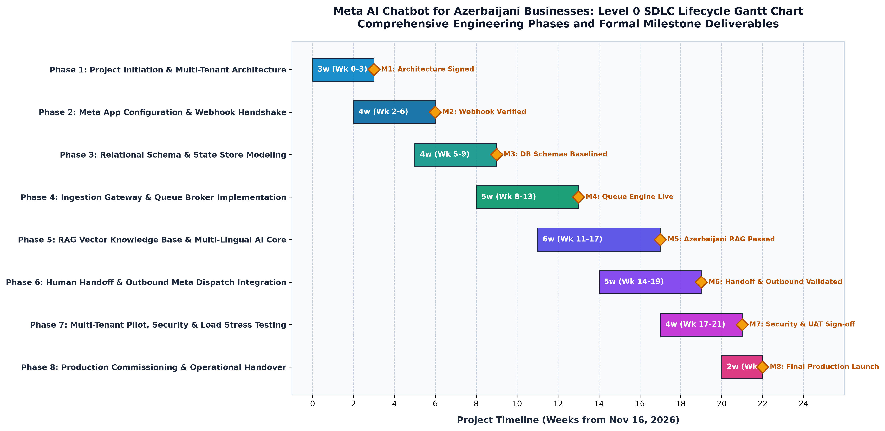
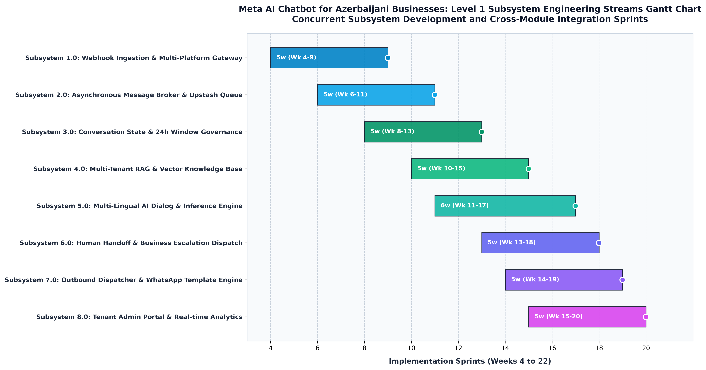
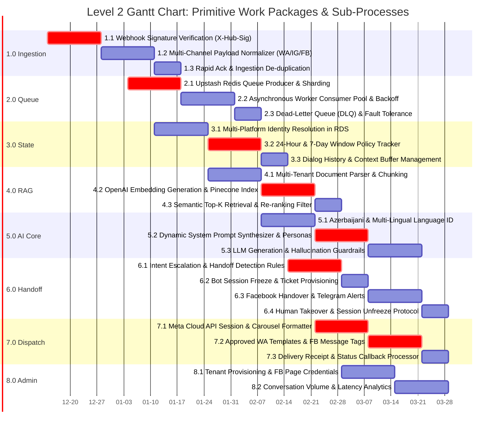
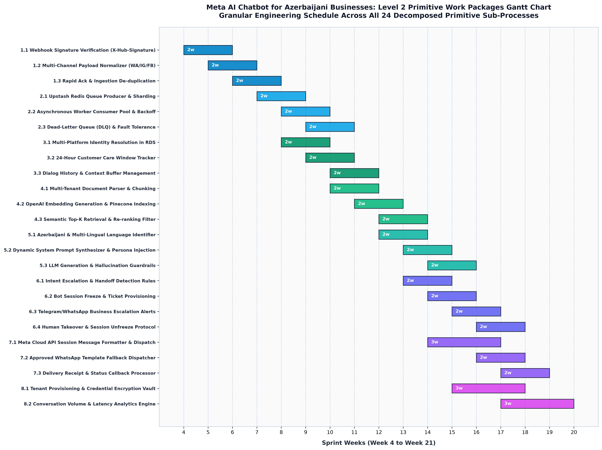
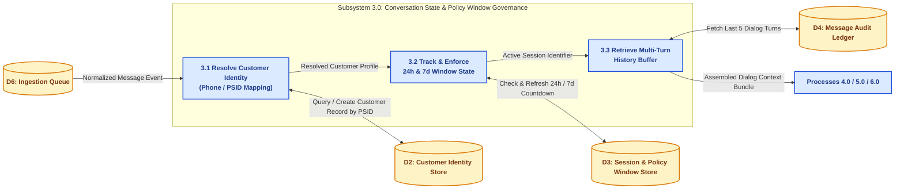
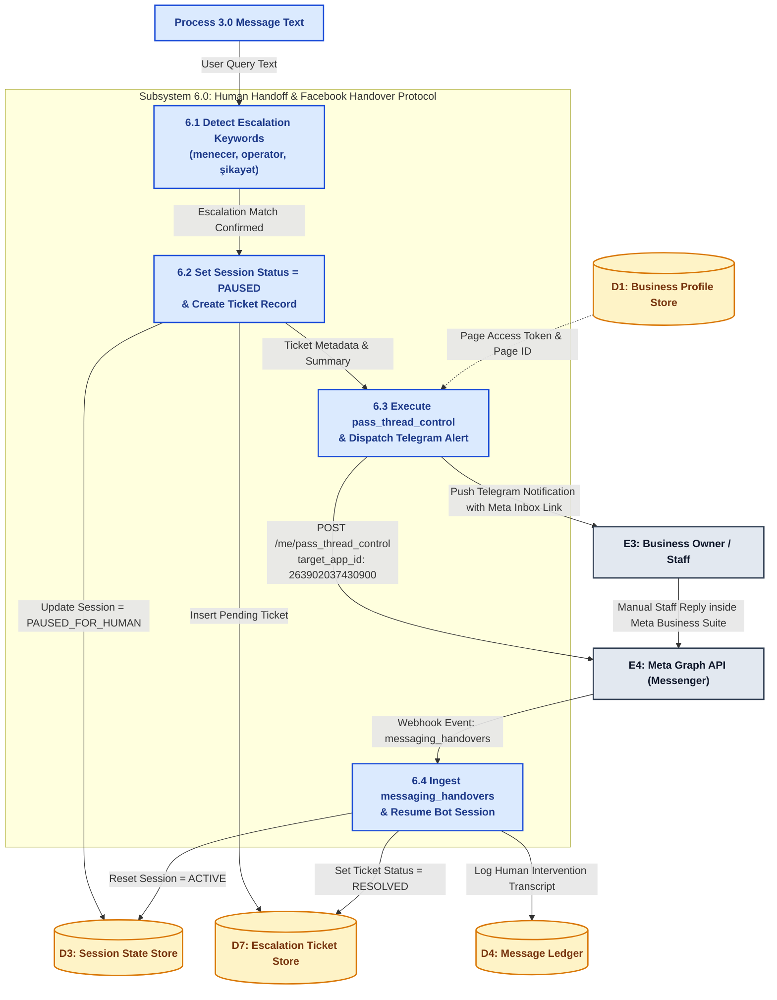
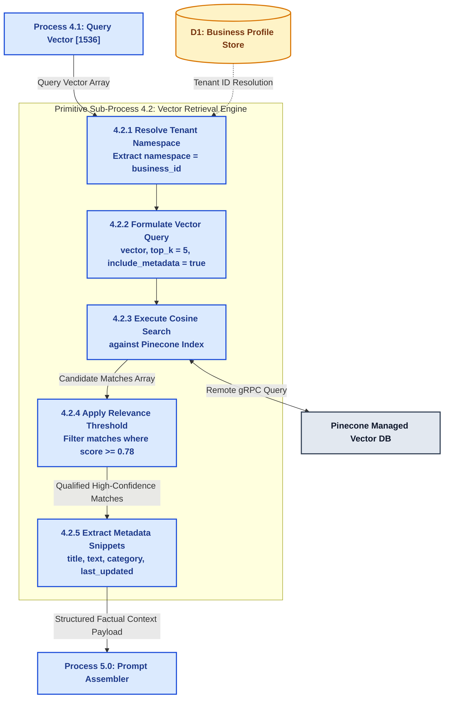
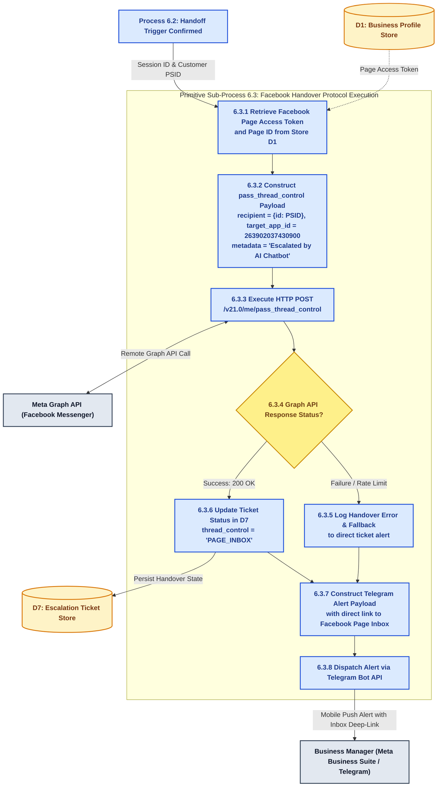

# System Analysis & Design Specification (SAD): Meta AI Chatbot for Azerbaijani Local Businesses

**Project Title:** Meta AI Chatbot for Azerbaijani Local Businesses  
**Document Type:** Systems Analysis and Design (SAD) Specification  
**Methodological Framework:** Structured Systems Analysis (Gane & Sarson / DeMarco / BUCT Standards) & Object-Oriented Analysis (UML 2.5)  
**Target Environment:** Railway PaaS, AWS RDS (PostgreSQL), Upstash Redis, Pinecone Vector DB, Meta Cloud API (WhatsApp Cloud API, Instagram Graph API, Facebook Messenger Platform)  
**Author / Engineering Reference:** Nijat Alisoy (Referenced from Project Engineering Dossier `ALISOY_NIJAT_2026220022_SAD`)  
**Date of Baselining:** November 2026  

---

## 1. Executive Summary & Structured Analysis Principles

This document provides the formal **System Analysis and Design (SAD)** specification for the **Meta AI Chatbot for Azerbaijani Local Businesses**. It translates the high-level business goals and technical requirements defined in [`project_documentation.md`](file:///c:/Users/lenovo/Desktop/Chabot/project_documentation.md) into concrete, mathematically balanced system models, multi-tier execution schedules, and rigorous data flow architectures.

### 1.1 Methodological Rigor & Data Flow Conservation Rules

Adhering to classic Structured Analysis methodologies (Kendall & Kendall; Gane & Sarson; DeMarco) and the standards established in the reference system analysis project, this specification enforces four fundamental engineering invariants:

1. **Strict Level-to-Level Balancing:** Every inbound and outbound data flow at a parent diagram level (e.g., Level 0 Process 4.0) maps with 100% boundary equivalence to the child diagram (Level 1 Process 4.0), and down to Level 2 primitive transformations.
2. **Elimination of Pathological Processes:**
   * **No Black Holes:** Every functional process that accepts inbound data flows must generate at least one transformed outbound data flow or persist state to an authorized data store.
   * **No Miracles (Spontaneous Generation):** No process may produce outbound data without receiving adequate input data or querying a persistent data store.
   * **No Grey Holes:** Outputs from a process must be mathematically and logically derivable from its stated inputs.
3. **Decoupled Data Store & Entity Interactions:** Direct data flow between two external entities, between two passive data stores, or directly between an external entity and a data store is strictly prohibited. All data transactions must pass through an active, mediating transformation process.
4. **Master Store Referencing (D1 through D10):** All persistent data interactions reference a centralized catalog of ten enterprise data stores, ensuring relational, caching, and vector indexing consistency across all architectural tiers.

---

## 2. Master System Directories (Entities & Data Stores)

### 2.1 External Entities Directory

| Entity ID | Entity Name | Classification | Operational Role & Boundary Definition |
| :--- | :--- | :--- | :--- |
| **E1** | **WhatsApp End-User** | Human External Actor | Mobile customers querying local Azerbaijani businesses via WhatsApp Business Platform / Cloud API. |
| **E2** | **Instagram & Facebook Messenger End-User** | Human External Actor | Social media customers interacting through Instagram DMs or **Facebook Messenger** (via mobile Messenger app, desktop web, Page buttons, and carousel interactions identified by Page-Scoped ID - PSID). |
| **E3** | **Business Owner / Manager** | Human Internal Actor | Azerbaijani merchants (restaurants, boutiques, clinics) managing catalogs, receiving Telegram escalation alerts, and taking over escalated chats inside **Meta Business Suite / Facebook Page Inbox**. |
| **E4** | **Meta Cloud Platform Gateway** | External Enterprise System | Meta's Graph API, Webhook Delivery Engine, WhatsApp Cloud API, and **Facebook Messenger Platform** (supporting Send API, Handover Protocol, and Message Tags). |
| **E5** | **LLM Inference Provider** | External AI Platform | OpenAI (GPT-4o) / Anthropic (Claude 3.5 Sonnet) providing natural language reasoning and generation. |
| **E6** | **Pinecone Vector Database** | External Cloud Service | High-performance managed vector database hosting business embeddings and RAG indexes. |
| **E7** | **System Admin & DevOps** | Human / Automated Actor | Engineering personnel monitoring Railway deployments, database migrations, and telemetry. |

### 2.2 Enterprise Data Stores Directory (D1 through D10)

| Store ID | Store Name | Storage Engine | Schema & Data Managed | Retention / Lifespan |
| :--- | :--- | :--- | :--- | :--- |
| **D1** | **Business Profile & Tenant Store** | AWS RDS (PostgreSQL) | Multi-tenant profiles, business hours, addresses, phone contacts, Meta WABA IDs, **Facebook Page IDs**, encrypted **Facebook Page Access Tokens (PAT)**, Instagram IDs, subscription status. | Permanent (Relational) |
| **D2** | **Customer Identity & Profile Store** | AWS RDS (PostgreSQL) | Scoped user IDs (`wa_id`, `ig_id`, **`fb_psid`**), customer names, preferred languages (AZ, RU, TR, EN), interaction timestamps. | Permanent (Relational) |
| **D3** | **Conversation Session & Window Store** | AWS RDS & Upstash Redis | Active session IDs, state flags (`ACTIVE`, `PAUSED_FOR_HUMAN`, `CLOSED`), channel type, last inbound timestamp, **24h Standard Window** and **Facebook 7-Day `HUMAN_AGENT` Tag Window** timers. | Active TTL + Archival |
| **D4** | **Message Audit Ledger & History** | AWS RDS (PostgreSQL) | Full conversation transcripts across WhatsApp, Instagram, and Messenger, inbound payloads, outbound responses, applied message tags, token usage metrics, latency records. | Permanent (Compliance) |
| **D5** | **Business Knowledge Base & Vector Index** | Pinecone Vector DB | Multi-tenant dense vector embeddings (OpenAI `text-embedding-3-small`), chunked menus, FAQs, policies. | Dynamic Index |
| **D6** | **Asynchronous Ingestion Queue** | Upstash Redis | Distributed FIFO message queue buffering incoming Meta webhooks (WA, IG, FB) for decoupled worker processing. | In-flight / Ephemeral (TTL) |
| **D7** | **Human Handoff & Escalation Store** | AWS RDS (PostgreSQL) | Handoff tickets, trigger keywords, customer summaries, assigned staff member, **Facebook Handover Protocol status** (`THREAD_PASSED_TO_INBOX`, `THREAD_RECLAIMED`), resolution logs. | Permanent (Ticketing) |
| **D8** | **Meta Template & Message Tag Registry** | AWS RDS (PostgreSQL) | Catalog of pre-approved WhatsApp message templates and **Facebook Messenger Message Tags** (`HUMAN_AGENT`, `POST_PURCHASE_UPDATE`, `CONFIRMED_EVENT_UPDATE`). | Versioned Registry |
| **D9** | **System Security & Secrets Vault** | Railway Env / AWS Secrets | Meta App Secrets, System User Access Tokens, Page Access Tokens, OpenAI keys, Pinecone API keys, Webhook verification tokens. | Secure Encrypted |
| **D10** | **Analytics & Aggregation Store** | AWS RDS / Redis Timeseries | Aggregated KPIs, daily message volume by channel (WA vs IG vs FB), handoff rates, peak hours, average response latencies, language distribution. | Aggregated / Rolling |

---

## 3. Multi-Tier Project Scheduling (Gantt Charts)

Project execution is organized into a disciplined **3-Tier Gantt Schedule** strictly adhering to the Work Breakdown Structure (WBS) and Critical Path Method (CPM). 

* **Level 0 (SDLC Lifecycle):** Focuses on the overarching software engineering lifecycle across 8 formal phases and 8 delivery milestones (M1–M8).
* **Level 1 (Subsystems):** Tracks concurrent development streams across the 8 primary architectural subsystems (Processes 1.0–8.0).
* **Level 2 (Primitive Work Packages):** High-resolution engineering timeline detailing all 24 decomposed primitive sub-processes and their critical-path dependencies.

---

### 3.1 Level 0 Gantt Chart: SDLC Project Lifecycle & Milestone Roadmap

```mermaid
gantt
    title Level 0 Gantt Chart: SDLC Project Lifecycle & Milestones
    dateFormat  YYYY-MM-DD
    axisFormat  %b %d
    
    section Phase 1: Inception
    Phase 1: Inception & Multi-Tenant Architecture   :active, p1, 2026-11-16, 3w
    M1: Project Charter & Architecture Signed       :milestone, m1, after p1, 0d
    
    section Phase 2: Meta Handshake
    Phase 2: Meta App Setup & Webhook Baselining     :p2, 2026-11-30, 4w
    M2: Webhook Verification Baselined              :milestone, m2, after p2, 0d
    
    section Phase 3: DB & State
    Phase 3: Relational Schema & State Store Modeling:p3, 2026-12-21, 4w
    M3: RDS & Redis Schemas Baselined               :milestone, m3, after p3, 0d
    
    section Phase 4: Gateway & Queue
    Phase 4: Ingestion Gateway & Queue Broker Eng.  :p4, 2027-01-11, 5w
    M4: Ingestion Pipeline Verified                 :milestone, m4, after p4, 0d
    
    section Phase 5: AI & RAG
    Phase 5: RAG Vector Knowledge & Multi-Lingual AI :p5, 2027-02-01, 6w
    M5: Azerbaijani RAG Engine Passed               :milestone, m5, after p5, 0d
    
    section Phase 6: Handoff & Dispatch
    Phase 6: Human Handoff & Outbound Meta Dispatch :p6, 2027-02-22, 5w
    M6: Handoff & Outbound Validated                :milestone, m6, after p6, 0d
    
    section Phase 7: UAT & Security
    Phase 7: Multi-Tenant Pilot & Stress Testing    :p7, 2027-03-15, 4w
    M7: Security & Load Sign-Off                    :milestone, m7, after p7, 0d
    
    section Phase 8: Rollout
    Phase 8: Production Commissioning & Handover    :p8, 2027-04-05, 2w
    M8: Final Production Launch                     :milestone, m8, after p8, 0d
```

#### High-Resolution Publication Figure (Level 0)


#### Level 0 Milestone Delivery Matrix

| Milestone ID | Target Week | Deliverable / Verification Gate | Verification Criteria |
| :--- | :--- | :--- | :--- |
| **M1** | Week 3 | System Architecture & Multi-Tenant Blueprint | Formal sign-off on Railway Nixpacks, AWS RDS PostgreSQL, Upstash Redis, and Pinecone topologies. |
| **M2** | Week 6 | Meta Developer App & Webhook Verification | Successful HTTP GET challenge handshake and HMAC-SHA256 signature verification with Meta servers across WhatsApp, IG, and Facebook Messenger. |
| **M3** | Week 9 | Relational Schema & 24h Window Modeling | RDS migration scripts deployed; Redis session caching, PSID customer resolution, and 24-hour / 7-day window decrement logic baselined. |
| **M4** | Week 13 | High-Throughput Queue & Broker Execution | Ingestion gateway handles 2,000 req/min under 300ms latency with zero dropped messages via Upstash FIFO queue. |
| **M5** | Week 17 | Multi-Lingual RAG Knowledge Pipeline | Pinecone semantic retrieval achieves >92% accuracy on Azerbaijani, Russian, and Turkish local business datasets. |
| **M6** | Week 19 | Human Handoff & Outbound Dispatch | Handoff keyword detection correctly freezes bot, executes Facebook Handover Protocol (`pass_thread_control`), triggers Telegram alert, and routes expired chats to templates/tags. |
| **M7** | Week 21 | Pilot UAT, Pentest & Chaos Testing | End-to-end pilot with 5 Azerbaijani local merchants (restaurants/boutiques); penetration testing and rate-limit audit cleared across WhatsApp, Instagram, and Facebook Messenger. |
| **M8** | Week 22 | Production Commissioning & Handover | Cutover to live production domain on Railway; automated alerting, log aggregation, and client documentation active. |

---

### 3.2 Level 1 Gantt Chart: Subsystem Engineering Streams

```mermaid
gantt
    title Level 1 Gantt Chart: Subsystem Concurrent Engineering Streams
    dateFormat  YYYY-MM-DD
    axisFormat  %b %d
    
    section 1.0 Gateway
    Subsystem 1.0: Webhook Ingestion & Channel Gateway    :active, s1, 2026-12-14, 5w
    
    section 2.0 Broker
    Subsystem 2.0: Asynchronous Queue Broker (Upstash)    :s2, 2026-12-28, 5w
    
    section 3.0 State
    Subsystem 3.0: Conversation State & 24h Governance    :s3, 2027-01-11, 5w
    
    section 4.0 RAG Core
    Subsystem 4.0: Multi-Tenant RAG & Vector Knowledge    :s4, 2027-01-25, 5w
    
    section 5.0 AI Dialog
    Subsystem 5.0: Multi-Lingual AI Dialog & Inference    :s5, 2027-02-01, 6w
    
    section 6.0 Handoff
    Subsystem 6.0: Human Handoff & Escalation Dispatch    :s6, 2027-02-15, 5w
    
    section 7.0 Outbound
    Subsystem 7.0: Outbound Dispatcher & Template Engine  :s7, 2027-02-22, 5w
    
    section 8.0 Admin
    Subsystem 8.0: Tenant Admin Portal & Real-time Metrics:s8, 2027-03-01, 5w
```

#### High-Resolution Publication Figure (Level 1)


#### Subsystem Engineering Sprint Allocation

| Subsystem ID | Engineering Stream Name | Lead Core Components | Upstream Dependency | Downstream Integration |
| :--- | :--- | :--- | :--- | :--- |
| **1.0** | Webhook Ingestion & Gateway | FastAPI/Node.js Gateway, HMAC-SHA256 Auth, Multi-Channel Normalizer (WA/IG/FB) | Phase 2 Handshake | Subsystem 2.0 (Queue Producer) |
| **2.0** | Asynchronous Message Broker | Upstash Redis Queue, Consumer Worker Pool, Dead-Letter Queue | Subsystem 1.0 | Subsystems 3.0, 4.0, 5.0 |
| **3.0** | State & 24h Window Governance | AWS RDS PostgreSQL, Redis Session Cache, PSID Resolver, 24h & 7d Timer Logic | Subsystem 2.0 | Subsystems 5.0, 6.0, 7.0 |
| **4.0** | Multi-Tenant RAG Knowledge Base | Pinecone Vector DB, Document Parser, OpenAI Embeddings | Subsystem 2.0 | Subsystem 5.0 (Prompt Injection) |
| **5.0** | AI Dialog & Inference Engine | LangChain/LlamaIndex, Azerbaijani System Personas, LLM Client | Subsystems 3.0, 4.0 | Subsystems 6.0, 7.0 |
| **6.0** | Human Handoff & Escalation | Intent Parser, Bot Freeze, Facebook Handover Protocol (`pass_thread_control`), Telegram Alert Bot | Subsystem 5.0 | Subsystem 7.0, Meta Business Suite |
| **7.0** | Outbound Dispatcher & Templates | Meta Graph Client, Facebook Generic Carousels, WhatsApp Templates, Messenger Message Tags | Subsystems 3.0, 5.0, 6.0 | Meta Platform Delivery |
| **8.0** | Tenant Admin & Analytics | Merchant Dashboard, Document Uploader, Facebook Page Token Manager, Analytics | All Subsystems | Business Owner Interface |

---

### 3.3 Level 2 Gantt Chart: Primitive Work Packages (Critical Path)



#### High-Resolution Publication Figure (Level 2)


---

## 4. Comprehensive Data Flow Diagrams (DFDs)

### 4.1 Context Data Flow Diagram (Diagram 0.0)

The Context Diagram defines the macro boundary of the **Meta AI Chatbot System (Process 0.0)**, detailing all data flows exchanged across external human and technological entities, with full native representation of WhatsApp, Instagram, and **Facebook Messenger**.

```mermaid
flowchart TB
    %% External Entities
    E1["E1: WhatsApp Mobile User"]
    E2["E2: Instagram & Facebook Messenger User"]
    E3["E3: Business Owner / Manager (Meta Business Suite / Telegram)"]
    E4["E4: Meta Cloud Platform (WhatsApp, Instagram & Facebook Graph APIs)"]
    E5["E5: LLM Inference Platform (OpenAI/Anthropic)"]
    E6["E6: Pinecone Vector Database"]
    E7["E7: System Admin / DevOps"]

    %% Central System Boundary
    P0(("0.0<br/>Meta AI Chatbot<br/>System for Azerbaijani<br/>Local Businesses"))

    %% Inbound Flows to Process 0.0
    E1 -->|WhatsApp Inbound Message| E4
    E2 -->|Messenger Chat / Postback / DM| E4
    E4 -->|Raw Webhook Payload (messages, messaging_postbacks, mid, PSID)| P0
    E4 -->|Delivery Receipts & Read Callbacks| P0
    E4 -->|Handover Return Callback (messaging_handovers)| P0
    E3 -->|Business Catalogs, Menus & Working Hours| P0
    E3 -->|Manual Staff Reply inside Facebook Page Inbox| E4
    E5 -->|Generated Multi-Lingual AI Response| P0
    E6 -->|Top-K Context Chunks & Similarity Scores| P0
    E7 -->|System Config, API Keys & DB Migrations| P0

    %% Outbound Flows from Process 0.0
    P0 -->|HTTP 200 OK Fast Ingestion Ack (< 500ms)| E4
    P0 -->|Outbound WA Messages & Approved Templates| E4
    P0 -->|Outbound Messenger Messages, Carousels & Message Tags| E4
    P0 -->|Facebook Handover Protocol: pass_thread_control| E4
    E4 -->|Delivered Response Message| E1
    E4 -->|Delivered Response DM / Generic Carousel| E2
    E4 -.->|Routed Escalated Thread to Page Inbox| E3
    P0 -->|Instant Telegram Escalation Alert with Meta Inbox Link| E3
    P0 -->|Business Analytics & Conversation Transcripts| E3
    P0 -->|Structured Prompt & Historical Context| E5
    P0 -->|Dense Query Vector & Tenant Metadata Filter| E6
    P0 -->|Health Metrics, Latency Logs & Alerts| E7

    %% Styling
    classDef entity fill:#e2e8f0,stroke:#334155,stroke-width:2px,color:#0f172a,font-weight:bold;
    classDef process fill:#dbeafe,stroke:#1d4ed8,stroke-width:3px,color:#1e3a8a,font-weight:bold;
    class E1,E2,E3,E4,E5,E6,E7 entity;
    class P0 process;
```

#### Context Diagram Balancing & Interface Matrix

| Data Flow Identifier | Source Entity / Process | Target Destination | Carried Data Structures | Functional Purpose |
| :--- | :--- | :--- | :--- | :--- |
| `F01_RawWebhook` | E4 (Meta Cloud API) | Process 0.0 | JSON webhook payload (`entry[].messaging[]`), SHA-256 HMAC header | Delivers customer messages from WhatsApp, Instagram, and Facebook Messenger. |
| `F02_FastAck` | Process 0.0 | E4 (Meta Cloud API) | HTTP 200 OK (`{"status":"received"}`) | Prevents Meta webhook retry storms and throttling (< 500ms). |
| `F03_OutboundMessage`| Process 0.0 | E4 (Meta Cloud API) | JSON payload (`recipient.id`, `message.text`, `generic_template`, `messaging_type`, `tag`) | Dispatches AI answers, Messenger Generic Carousels, or tagged messages. |
| `F04_PassThreadControl`| Process 0.0 | E4 (Meta Cloud API) | POST `/me/pass_thread_control` (`recipient.id`, `target_app_id: 263902037430900`) | Releases Facebook Messenger thread to Facebook Page Inbox in Meta Business Suite. |
| `F05_BusinessContent`| E3 (Business Owner) | Process 0.0 | PDF/DOCX menus, price lists, hours, addresses | Populates RAG knowledge base for local Azerbaijani store. |
| `F06_HandoffAlert` | Process 0.0 | E3 (Business Owner) | Telegram alert with customer phone, issue summary, Meta Inbox link | Notifies merchant that a human agent is requested. |
| `F07_VectorQuery` | Process 0.0 | E6 (Pinecone DB) | 1536-dim vector, `tenant_id`, top-k parameter | Queries dense semantic index for relevant business facts. |
| `F08_ContextChunks` | E6 (Pinecone DB) | Process 0.0 | Array of text chunks, relevance scores | Provides verified factual groundings to prevent hallucinations. |
| `F09_LLMRequest` | Process 0.0 | E5 (OpenAI/Anthropic) | System prompt, conversation history, context | Invokes model with Azerbaijani persona instructions. |
| `F10_LLMResponse` | E5 (OpenAI/Anthropic) | Process 0.0 | Text string, token counts, finish reason | Raw AI-generated customer answer. |

---

### 4.2 Level 0 Data Flow Diagram: System Functional Decomposition

Level 0 decomposes the core system into **8 Primary Operational Subsystems (1.0 to 8.0)**, detailing all data exchanges with the **10 Enterprise Data Stores (D1 to D10)** and External Entities across WhatsApp, Instagram, and Facebook Messenger.

```mermaid
flowchart TB
    %% External Entities
    E3["E3: Business Owner"]
    E4["E4: Meta Cloud API (WA/IG/FB)"]
    E5["E5: LLM Provider"]
    E6["E6: Pinecone Vector DB"]

    %% Data Stores
    D1[("D1: Business Profile & Page Store")]
    D2[("D2: Customer Identity Store (PSID)")]
    D3[("D3: Session & Policy Window Store")]
    D4[("D4: Message Audit Ledger")]
    D5[("D5: Knowledge Base & Vector Index")]
    D6[("D6: Asynchronous Ingestion Queue")]
    D7[("D7: Escalation Ticket Store")]
    D8[("D8: Template & Message Tag Registry")]
    D9[("D9: System Secrets Vault")]
    D10[("D10: Analytics Store")]

    %% Primary Processes
    P1["1.0<br/>Webhook Ingestion &<br/>Security Gateway"]
    P2["2.0<br/>Asynchronous Queue &<br/>Broker Management"]
    P3["3.0<br/>Conversation State &<br/>Policy Window Governance"]
    P4["4.0<br/>Multi-Tenant RAG &<br/>Vector Retrieval"]
    P5["5.0<br/>AI Generation &<br/>Multi-Lingual Engine"]
    P6["6.0<br/>Human Handoff &<br/>Facebook Handover Protocol"]
    P7["7.0<br/>Outbound Message<br/>Dispatcher & Carousels"]
    P8["8.0<br/>Business Tenant &<br/>Knowledge Admin"]

    %% Ingestion & Queue Flows
    E4 -->|Raw Webhook & Signature (WA/IG/FB)| P1
    D9 -.->|App Secret| P1
    P1 -->|HTTP 200 Ack| E4
    P1 -->|Verified Normalized Event| P2
    P2 -->|Enqueue Event| D6
    D6 -->|Dequeue Event| P2
    P2 -->|Processed Message Task| P3

    %% State & Customer Governance
    P3 <-->|Lookup / Update Customer (PSID/Phone)| D2
    P3 <-->|Get / Update Session & 24h / 7d Window| D3
    P3 -->|Active Inbound Context| P4
    P3 -->|Active Inbound Context| P6

    %% RAG & Vector Retrieval
    P4 -->|Embed Query Vector| E6
    E6 -->|Relevant Facts & Chunks| P4
    P4 -->|Augmented Prompt Context| P5

    %% AI Dialog Engine
    D1 -.->|Business Persona & Rules| P5
    P5 -->|Inference Call| E5
    E5 -->|Raw AI Response| P5
    P5 -->|Generated Message Text / Carousels| P7

    %% Escalation & Facebook Handover
    P6 -->|Check Handoff Intent| P3
    P6 -->|Create Ticket & Freeze Bot| D7
    P6 -->|Execute pass_thread_control to Page Inbox| E4
    P6 -->|Push Telegram Alert with Meta Inbox Link| E3
    E3 -->|Manual Resolution / Unfreeze| P6

    %% Outbound Dispatch
    P7 <-->|Verify 24h Window / Tag Eligibility| D3
    D8 -.->|Select Approved WA Template / FB Tag| P7
    D1 -.->|Facebook Page Access Token / WABA Token| P7
    P7 -->|Dispatch Graph API Call (/me/messages)| E4
    P7 -->|Write Interaction Log & Channel Tag| D4
    P7 -->|Emit Channel Performance Metrics| D10

    %% Admin & Ingestion
    E3 -->|Upload Menu / FAQ Docs & Connect FB Page| P8
    P8 -->|Chunk & Upsert Vectors| D5
    P8 -->|Update Business Profile & Page Access Tokens| D1
    D10 -->|View Multi-Channel Analytics Dashboard| E3

    %% Styling
    classDef entity fill:#e2e8f0,stroke:#334155,stroke-width:2px,color:#0f172a,font-weight:bold;
    classDef process fill:#dbeafe,stroke:#1d4ed8,stroke-width:2px,color:#1e3a8a,font-weight:bold;
    classDef store fill:#fef3c7,stroke:#d97706,stroke-width:2px,color:#78350f,font-weight:bold;
    class E3,E4,E5,E6 entity;
    class P1,P2,P3,P4,P5,P6,P7,P8 process;
    class D1,D2,D3,D4,D5,D6,D7,D8,D9,D10 store;
```

---

### 4.3 Level 1 Data Flow Diagrams (Subsystem Decompositions)

#### 4.3.1 Level 1 DFD: Process 1.0 (Webhook Ingestion & Security Gateway)

Decomposes Process 1.0 into its constituent sub-processes, handling WhatsApp, Instagram, and **Facebook Messenger**:
* **1.1 Authenticate & Verify Webhook Signatures**
* **1.2 Ingest & Normalize Multi-Channel Payloads**
* **1.3 Acknowledge Handshake & Filter Duplicates**

```mermaid
flowchart LR
    E4["E4: Meta Cloud Platform"]
    D9[("D9: System Secrets Vault")]
    D6[("D6: Upstash Ingestion Queue")]

    subgraph Subsystem_1_0 ["Subsystem 1.0: Webhook Ingestion & Security Gateway"]
        P1_1["1.1 Authenticate & Verify<br/>HMAC Signature"]
        P1_2["1.2 Normalize Multi-Channel<br/>Payload (WA, IG, FB)"]
        P1_3["1.3 Rapid Ack &<br/>De-duplicate Event"]
    end

    E4 -->|HTTP POST Webhook & X-Hub-Signature| P1_1
    D9 -.->|Meta App Secret| P1_1
    P1_1 -->|Authenticated Raw Payload| P1_2
    P1_1 -.->|Invalid Signature Reject (403)| E4
    P1_2 -->|Canonical Internal Message Object<br/>(Extracts PSID, mid, postback)| P1_3
    P1_3 -->|HTTP 200 OK (< 500ms)| E4
    P1_3 -->|Idempotent Event Payload| D6

    classDef entity fill:#e2e8f0,stroke:#334155,stroke-width:2px,color:#0f172a,font-weight:bold;
    classDef process fill:#dbeafe,stroke:#1d4ed8,stroke-width:2px,color:#1e3a8a,font-weight:bold;
    classDef store fill:#fef3c7,stroke:#d97706,stroke-width:2px,color:#78350f,font-weight:bold;
    class E4 entity;
    class P1_1,P1_2,P1_3 process;
    class D9,D6 store;
```

#### 4.3.2 Level 1 DFD: Process 3.0 (Conversation State & Policy Window Governance)

Decomposes Process 3.0 into:
* **3.1 Resolve Customer Identity Across Channels (PSID / Phone / IGSID Mapping)**
* **3.2 Evaluate Policy Windows (24h Standard vs 7-Day Facebook `HUMAN_AGENT` Tag)**
* **3.3 Assemble Multi-Turn History Buffer**



#### 4.3.3 Level 1 DFD: Process 4.0 (Multi-Tenant RAG & Vector Knowledge Retrieval)

Decomposes Process 4.0 into:
* **4.1 Embed User Query into Dense Vector Space**
* **4.2 Execute Multi-Tenant Similarity Search (Pinecone)**
* **4.3 Re-Rank & Synthesize Factual Context Chunks**

```mermaid
flowchart LR
    P3["Process 3.0 Context"]
    E5["E5: OpenAI Embeddings API"]
    E6["E6: Pinecone Vector Database"]
    P5["Process 5.0: Dialog Engine"]

    subgraph Subsystem_4_0 ["Subsystem 4.0: Multi-Tenant RAG & Vector Retrieval"]
        P4_1["4.1 Generate Query Embedding<br/>(text-embedding-3-small)"]
        P4_2["4.2 Query Pinecone Index<br/>(Filtered by Tenant ID)"]
        P4_3["4.3 Score, Re-Rank &<br/>Assemble Context Buffer"]
    end

    P3 -->|Customer Query Text & Tenant ID| P4_1
    P4_1 <-->|Embed String -> 1536-dim Float Array| E5
    P4_1 -->|Dense Vector & Namespace Metadata| P4_2
    P4_2 <-->|Cosine Similarity Search (Top-5)| E6
    P4_2 -->|Raw Candidate Matches| P4_3
    P4_3 -->|Ranked Factual Context Snippets| P5

    classDef entity fill:#e2e8f0,stroke:#334155,stroke-width:2px,color:#0f172a,font-weight:bold;
    classDef process fill:#dbeafe,stroke:#1d4ed8,stroke-width:2px,color:#1e3a8a,font-weight:bold;
    class E5,E6 entity;
    class P3,P4_1,P4_2,P4_3,P5 process;
```

#### 4.3.4 Level 1 DFD: Process 6.0 (Human Handoff & Facebook Handover Protocol)

Decomposes Process 6.0 into:
* **6.1 Detect Escalation Intent & Frustration Keywords**
* **6.2 Freeze Bot Session & Provision Escalation Ticket**
* **6.3 Execute Facebook Handover Protocol (`pass_thread_control`) & Telegram Alert**
* **6.4 Handle Human Takeover & Resume Bot State (`take_thread_control`)**



#### 4.3.5 Level 1 DFD: Process 7.0 (Outbound Message Dispatcher & Multi-Channel Formatting)

Decomposes Process 7.0 into:
* **7.1 Format Interactive Session Message & Facebook Generic Carousels**
* **7.2 Parameterize WhatsApp Templates or Facebook Message Tags (`HUMAN_AGENT`)**
* **7.3 Dispatch Meta Graph Request & Ingest Delivery Receipts**

```mermaid
flowchart LR
    P5["Process 5.0 (AI Text / Data)"]
    D3[("D3: Session Window Store")]
    D8[("D8: Template & Tag Registry")]
    D1[("D1: Page Credentials")]
    D4[("D4: Message Ledger")]
    E4["E4: Meta Graph API"]

    subgraph Subsystem_7_0 ["Subsystem 7.0: Outbound Dispatcher & Multi-Channel Formatting"]
        P7_1["7.1 Construct Session Payload<br/>(Text / Quick Replies / Carousels)"]
        P7_2["7.2 Parameterize WhatsApp Template<br/>or Facebook Message Tag"]
        P7_3["7.3 Transmit HTTP POST<br/>& Record Receipt"]
    end

    P5 -->|AI Response Text / Carousel Elements| P7_1
    D3 -.->|Window Status: OPEN_24H| P7_1
    D3 -.->|Window Status: EXPIRED / EXTENDED_TAG| P7_2
    D8 -.->|Approved WA Template / FB Tag Rule| P7_2
    P7_1 -->|Standard JSON / Generic Carousel Payload| P7_3
    P7_2 -->|Tagged Messenger Payload / Template JSON| P7_3
    D1 -.->|Page Access Token / WABA Token| P7_3
    P7_3 -->|POST /me/messages (FB/IG) or /messages (WA)| E4
    E4 -->|Message ID & Delivery Callback| P7_3
    P7_3 -->|Persist Outbound Record| D4

    classDef entity fill:#e2e8f0,stroke:#334155,stroke-width:2px,color:#0f172a,font-weight:bold;
    classDef process fill:#dbeafe,stroke:#1d4ed8,stroke-width:2px,color:#1e3a8a,font-weight:bold;
    classDef store fill:#fef3c7,stroke:#d97706,stroke-width:2px,color:#78350f,font-weight:bold;
    class E4 entity;
    class P5,P7_1,P7_2,P7_3 process;
    class D3,D8,D1,D4 store;
```

---

### 4.4 Level 2 Data Flow Diagrams (Mission-Critical Primitive Sub-Processes)

#### 4.4.1 Level 2 DFD for Sub-Process 1.1: Webhook Cryptographic Verification & Ingestion Handshake

Detailed specification of the incoming HTTP request authentication gateway:

```mermaid
flowchart TD
    E4["Meta Webhook Engine"]
    D9[("D9: System Secrets Vault")]
    P1_2["Process 1.2: Normalizer"]

    subgraph P1_1_Decomposition ["Primitive Sub-Process 1.1: Cryptographic Authentication"]
        A["1.1.1 Intercept HTTP Request<br/>Extract Header X-Hub-Signature-256"]
        B{"1.1.2 Request Method Type?"}
        C["1.1.3 Verify Hub Challenge<br/>hub.verify_token == APP_VERIFY_TOKEN"]
        D["1.1.4 Read Raw Request Bytes<br/>Compute HMAC-SHA256(RawBody, AppSecret)"]
        E{"1.1.5 Constant-Time Comparison<br/>ComputedHash == ProvidedHash?"}
        F["1.1.6 Return HTTP 403 Forbidden<br/>Log Security Anomaly"]
        G["1.1.7 Return hub.challenge<br/>HTTP 200 OK"]
        H["1.1.8 Forward Verified Payload<br/>to Canonical Normalizer"]
    end

    E4 -->|GET /webhook (Handshake)| A
    E4 -->|POST /webhook (Event Data)| A
    A --> B
    B -->|GET| C
    B -->|POST| D
    D9 -.->|App Secret & Verify Token| C
    D9 -.->|App Secret Key| D
    C -->|Valid Token| G
    C -->|Invalid Token| F
    D --> E
    E -->|Hash Match| H
    E -->|Hash Mismatch| F
    G -->|Challenge Echo| E4
    F -->|Access Denied| E4
    H -->|Verified Raw Body| P1_2

    classDef entity fill:#e2e8f0,stroke:#334155,stroke-width:2px,color:#0f172a,font-weight:bold;
    classDef process fill:#dbeafe,stroke:#1d4ed8,stroke-width:2px,color:#1e3a8a,font-weight:bold;
    classDef decision fill:#fef08a,stroke:#ca8a04,stroke-width:2px,color:#713f12,font-weight:bold;
    classDef store fill:#fef3c7,stroke:#d97706,stroke-width:2px,color:#78350f,font-weight:bold;
    class E4 entity;
    class A,C,D,F,G,H,P1_2 process;
    class B,E decision;
    class D9 store;
```

#### 4.4.2 Level 2 DFD for Sub-Process 4.2: Multi-Tenant Vector Similarity Search & Context Augmentation

Detailed specification of the multi-tenant Pinecone vector query execution:



#### 4.4.3 Level 2 DFD for Sub-Process 6.3: Facebook Messenger Handover Protocol & Thread Control Routing

Detailed specification of passing thread control to the Facebook Page Inbox upon human escalation:



#### 4.4.4 Level 2 DFD for Sub-Process 7.2: Facebook Messenger Multi-Format Outbound & Message Tag Dispatch

Detailed specification of constructing Facebook Messenger Generic Carousel Templates and Message Tag routing:

```mermaid
flowchart TD
    P5["Process 5.0: Structured Response Data"]
    D3[("D3: Session Window Store")]
    D1[("D1: Business Profile Store")]
    E4["Meta Graph API (/me/messages)"]
    D4[("D4: Message Audit Ledger")]

    subgraph P7_2_Decomposition ["Primitive Sub-Process 7.2: Facebook Messenger Outbound Construction"]
        M1{"7.2.1 Check Session Window Policy"}
        M2{"7.2.2 Message Structure Type?"}
        M3["7.2.3 Construct Standard Text Message<br/>messaging_type = 'RESPONSE'"]
        M4["7.2.4 Construct Generic Carousel Template<br/>attachment.type = 'template', elements = [...]<br/>(Image, Title, Subtitle, URL & Postback Buttons)"]
        M5{"7.2.5 Elapsed Time <= 7 Days?"}
        M6["7.2.6 Attach HUMAN_AGENT Message Tag<br/>messaging_type = 'MESSAGE_TAG', tag = 'HUMAN_AGENT'"]
        M7["7.2.7 Return Policy Violation (Window Closed)<br/>Prompt user via sponsored/template fallback"]
        M8["7.2.8 Sign Payload with Page Access Token<br/>Execute HTTP POST /me/messages"]
    end

    P5 -->|AI Output (Text / Product Cards)| M1
    D3 -.->|Last Inbound Timestamp & Channel| M1
    M1 -->|Within 24 Hours| M2
    M1 -->|Outside 24 Hours| M5
    M2 -->|Simple Text| M3
    M2 -->|Catalog / Menu Cards| M4
    M5 -->|True: <= 7 Days| M6
    M5 -->|False: > 7 Days| M7
    M3 --> M8
    M4 --> M8
    M6 --> M8
    D1 -.->|Page Access Token| M8
    M8 <-->|HTTPS POST /me/messages| E4
    M8 -->|Record Outbound Audit Record| D4

    classDef process fill:#dbeafe,stroke:#1d4ed8,stroke-width:2px,color:#1e3a8a,font-weight:bold;
    classDef store fill:#fef3c7,stroke:#d97706,stroke-width:2px,color:#78350f,font-weight:bold;
    classDef decision fill:#fef08a,stroke:#ca8a04,stroke-width:2px,color:#713f12,font-weight:bold;
    classDef entity fill:#e2e8f0,stroke:#334155,stroke-width:2px,color:#0f172a,font-weight:bold;
    class E4 entity;
    class M3,M4,M6,M7,M8,P5 process;
    class M1,M2,M5 decision;
    class D3,D1,D4 store;
```

---

## 5. Architectural Alignment & Cross-Reference

This System Analysis and Design specification works hand-in-hand with the main project dossier:

* **Functional Decomposition Matrix & Primitive Functions:** Defined in Section 3 of [`project_documentation.md`](file:///c:/Users/lenovo/Desktop/Chabot/project_documentation.md).
* **Domain Model & UML Class Diagram:** Defined in Section 4 of [`project_documentation.md`](file:///c:/Users/lenovo/Desktop/Chabot/project_documentation.md).
* **System Architecture & Tech Stack:** Outlined in Section 1 of [`project_documentation.md`](file:///c:/Users/lenovo/Desktop/Chabot/project_documentation.md).
* **Generated High-Resolution Figures:** Stored in [`doc_images/`](file:///c:/Users/lenovo/Desktop/Chabot/doc_images/) (`gantt_level0.png`, `gantt_level1.png`, `gantt_level2.png`).
